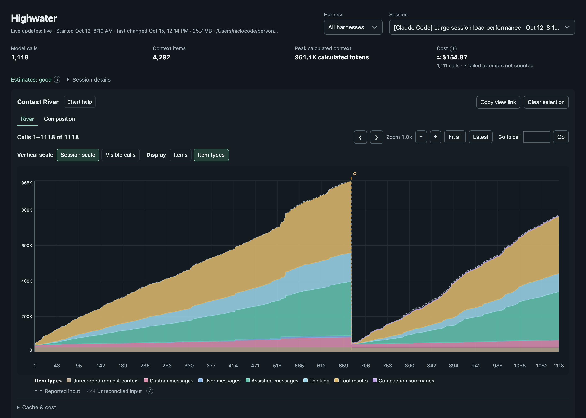

#  Highwater

Highwater shows how a coding agent's context window fills up over a session. It reads the session files that Pi, OpenCode, Claude Code and VS Code Copilot Chat already write, rebuilds what was in context at every model call, and draws each item (messages, tool results, the system prompt, compaction summaries) as a band that you can follow from the call where it appears to the call where it leaves.



- **Context River:** every context item's estimated size at every call, with compactions, the input each call reported, and zoom, pan and keyboard navigation.
- **Composition:** what made up the context at one call, or across the session, as a treemap or a ranked list.
- **Context lifespans:** when each item entered and left the context, searchable and filterable.
- **Cache and cost:** cache reads and writes per call, and each call's cost, recorded or estimated from bundled price data.

Everything runs locally. Highwater serves its interface on `127.0.0.1`, reads session files without changing them, and never sends session content anywhere.

## Install

Highwater needs Rust 1.88 or newer. The built interface is included in the repository, so Node is not needed to install it.

```bash
git clone https://github.com/nickcox/highwater.git
cd highwater
cargo install --path . --locked
```

## Run

```bash
highwater
```

Then open the URL it prints. Without options, Highwater finds sessions in each tool's default location, when it exists:

| Source | Default location | Option |
| --- | --- | --- |
| Pi | `~/.pi/agent/sessions` | `--session-root <dir>` |
| OpenCode | `opencode.db` and `opencode-stable.db` in `$XDG_DATA_HOME/opencode` (default `~/.local/share/opencode`) | `--opencode-db <file>` (repeatable) |
| Claude Code | `$CLAUDE_CONFIG_DIR/projects` (default `~/.claude/projects`) | `--claude-root <dir>` (repeatable) |
| VS Code Copilot Chat | VS Code's and VS Code Insiders' user data folders | `--vscode-user-dir <dir>` (repeatable) |

An option replaces that source's default. `--session-root` on its own reads only Pi sessions; add the other options to include them too. Other options: `--port` (default 43123) and `--tokenization auto|strict|heuristic|off`.

The server binds only to `127.0.0.1` and rejects requests that address it by any other name, so other web pages cannot read session data through it.

## How accurate it is

Session files record how many input tokens each call used, and some record its cost, but none record how those tokens divide between items. Highwater counts each item's tokens locally, with OpenAI's tokenizers, a port of [ctok](https://github.com/sanderland/ctok)'s reconstructed Claude tokenizers, or a character estimate, and compares the total with the input each call reported. The **Estimates** indicator rates how closely they match. Some content is not recorded at all, such as the system prompt in Claude Code; Highwater shows that as a separate measured item rather than guessing its contents. [Data semantics](docs/data-semantics.md) explains what is recorded, what is estimated and how missing values are kept apart.

## Documentation

- [User guide](docs/user-guide.md): the River, Composition, lifespans, view links and the cache and cost track.
- [Data semantics](docs/data-semantics.md): tokenization, cost, the analysis API, and what each number means.
- Sources: [Pi](docs/sources/pi.md), [OpenCode](docs/sources/opencode.md), [Claude Code](docs/sources/claude-code.md) and [VS Code Copilot Chat](docs/sources/vscode-copilot.md).
- [Architecture](docs/architecture.md) and [development](docs/development.md): how it is built, and how to change and check it.

## Third-party data

Highwater includes data from other projects, each under the MIT licence:

- Model prices from [models.dev](https://github.com/sst/models.dev) and corrections from [wakamex/model-prices](https://github.com/wakamex/model-prices): see [data/prices](data/prices/README.md).
- Claude tokenizer vocabularies from [ctok](https://github.com/sanderland/ctok): see `data/tokenization/LICENSE.ctok`.

## Licence

[MIT](LICENSE)
